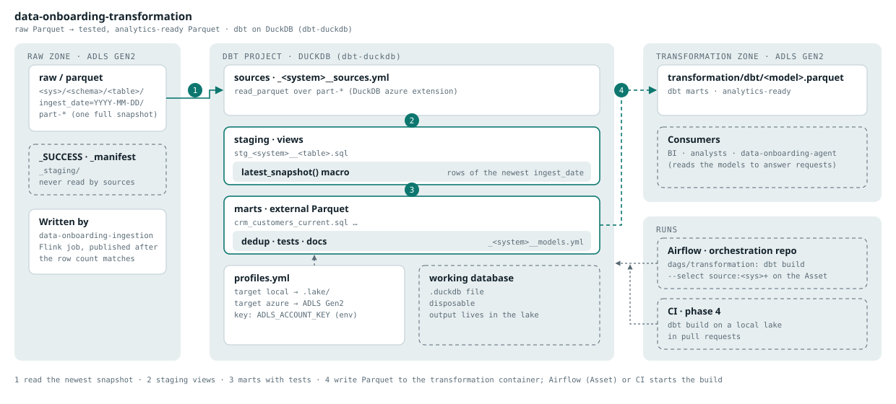

# data-onboarding-transformation

Transformation layer for onboarded data: **dbt models on DuckDB (dbt-duckdb)** that read the raw Parquet landed in ADLS Gen2 by [data-onboarding-ingestion](https://github.com/thanhphat2609/data-onboarding-ingestion) and write deduplicated, tested, analytics-ready Parquet to the transformation container.

## Status

**v0.1.0: initial project setup.** dbt project, profiles for a local lake and ADLS, first staging model and mart. Not yet run against a real storage account.

## How it fits



```
data-onboarding-ingestion                      data-onboarding-transformation (this repo)
  Flink job ─▶ abfss://raw@<account>/parquet/<system>/<schema>/<table>/ingest_date=YYYY-MM-DD/part-*
                                   │
                                   ▼ read_parquet (DuckDB azure extension)
                             staging views ─▶ marts ─▶ abfss://transformation@<account>/dbt/<model>.parquet
```

- Each `ingest_date` partition is one full snapshot of the source table (ingestion ADR-0004). Sources read only `part-*` files, so `_SUCCESS`, `_manifest.json` and `_staging/` are never picked up.
- DuckDB is only the compute engine. The output lives in the lake as Parquet; the `.duckdb` file is a disposable working database.

## Layout

```
dbt_project.yml        project config: staging = views, marts = external Parquet
profiles.yml           targets local (lake under .lake/) and azure (ADLS Gen2); secrets from env vars
models/
  staging/<system>/    _<system>__sources.yml, stg_<system>__<table>.sql
  marts/<system>/      models written to the transformation container
macros/                latest_snapshot(): rows of the most recent ingest day
analyses/ seeds/ snapshots/
```

## Getting started

```bash
python -m venv .venv
.venv/Scripts/pip install -r requirements.txt     # Linux/macOS: .venv/bin/pip
cp .env.example .env                              # fill in the storage account and lake roots
dbt debug
dbt build                                         # DBT_TARGET=local (default) or azure
```

| Variable | Meaning |
|---|---|
| `DBT_TARGET` | `local` (lake under `.lake/`), `azure` (`az login` or service principal) or `azure_key` (account key) |
| `ADLS_STORAGE_ACCOUNT` | ADLS Gen2 account used by ingestion (same name as in data-onboarding-ingestion) |
| `ADLS_ACCOUNT_KEY` | Account key, only for `DBT_TARGET=azure_key` (GitHub secret of the same name). With it use `azure://` paths, e.g. `LAKE_RAW_ROOT=azure://raw/parquet`: the key does not work with `abfss://` |
| `LAKE_RAW_ROOT` | e.g. `abfss://raw@<account>.dfs.core.windows.net/parquet` |
| `LAKE_CURATED_ROOT` | e.g. `abfss://transformation@<account>.dfs.core.windows.net/dbt` |
| `AZURE_TENANT_ID`, `AZURE_CLIENT_ID`, `AZURE_CLIENT_SECRET` | Service principal for CI; empty = use `az login` |

For the local target, put Parquet in the same layout under `.lake/raw/parquet/` and create `.lake/curated/` (DuckDB does not create missing folders on local disk).

On Windows, if `pip install` fails with a missing file under `metricflow_semantic_interfaces`, the path is too long: create the venv in a short path or enable long paths.

## Roadmap

| Phase | Content | Depends on |
|---|---|---|
| 0 – Setup | dbt project, profiles, first models (**v0.1.0**) | |
| 1 – Azure dev run | `dbt build --target azure` against the dev storage account; transformation container and permissions | Dev ADLS access (ingestion Phase 0) |
| 2 – Models per onboarded table | Staging + marts for each ingestion job; tests and docs | Ingestion jobs landing data |
| 3 – Airflow DAG | DAG in `dags/transformation/` of the shared Airflow, scheduled on the Asset of each published table (ingestion ADR-0008), runs `dbt build --select source:<system>+` | Ingestion Phase 5: `publish` emits Assets |
| 4 – CI | `dbt build` on a local lake in pull requests | |

## Conventions

Same as [data-onboarding-ingestion/CONTRIBUTING.md](https://github.com/thanhphat2609/data-onboarding-ingestion/blob/main/CONTRIBUTING.md): English only, Conventional Commits, Semantic Versioning with annotated tags on `main`, no secrets in files.
